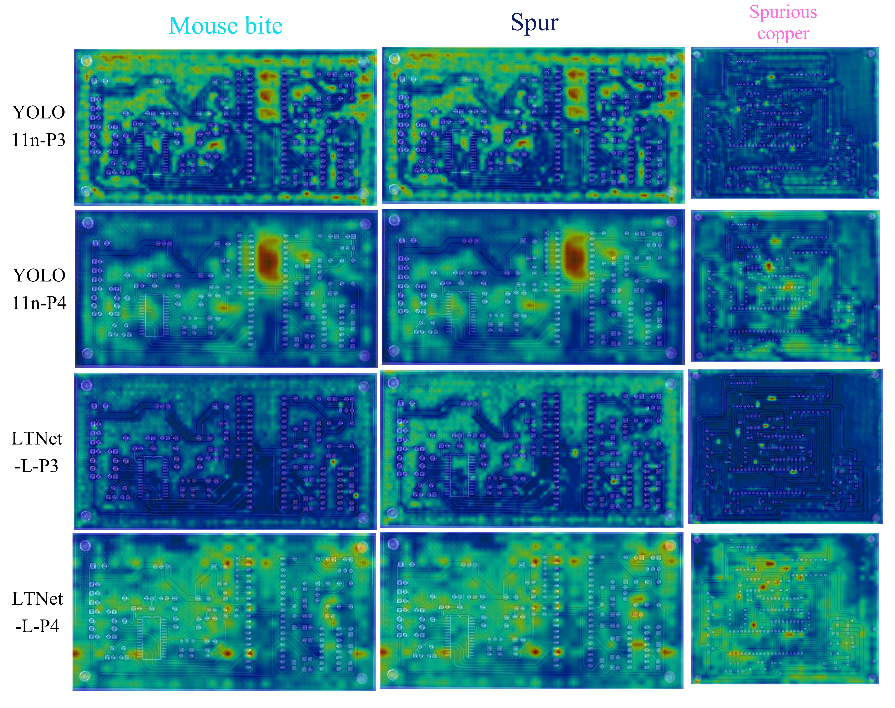

> 🔙 [Return to the main README](README.md)
# LTNet:LTNet: A Lightweight High-Performance Network for Coping with Tiny Surface Defect Inspection in Automated PCB Manufacturing(The paper is being submitted)
## Abstract
Quality control of Printed Circuit Boards (PCBs) is critical for ensuring their performance and reliability. Although deep learning-based algorithms have been widely integrated into PCB manufacturing quality control for surface defect inspection, the field still faces challenges such as sparse and low-salience defect features, severe background interference, and the high computational costs of existing models. To mitigate these issues, this work proposes LTNet (Lower Triangle Network), a lightweight detection model based on YOLOv11n. LTNet offers three variants, S, M, and L, enabling flexible adaptation to various computational power scenarios. The core contributions of LTNet are as follows: First, a C3K2-MILABlock(Mamba-Inspired Linear Attention) enhances defect feature representation. Second, theoretically proving the equivalence between SPDConv and $2 \times 2$ strided convolution enables the construction of the fine-grained receptive field LT backbone, thereby heightening the model's sensitivity to tiny defects. Third, designing the Adaptive Feature Compression Module (AFCM) and restructuring the neck network optimizes the transmission and fusion of multi-scale features. Finally, the Normalized Gaussian Wasserstein Distance (NWD) optimizes the loss function, enhancing the stability of micro-defect detection. On the PKU-Market-PCB dataset, LTNet-L (with an ultra-lightweight footprint of 1.02M parameters and 12.7 GFLOPs at $640 \times 640$ resolution) achieves an mAP, $\text{mAP}_{50}$, Precision, and Recall of 58.4\%, 98.8\%, 97.5\%, and 98.8\%, respectively. Notably, the exceptionally high recall rate of 98.8\% perfectly aligns with the stringent 'zero-misdetection' requirement in industrial quality control. Cross-dataset validation on DeepPCB further corroborates the model’s superior generalization capability, and it exhibits outstanding competitiveness against state-of-the-art task-specific PCB defect detection models. The code \url{https://anonymous.4open.science/r/LTNet-B7DE} will be made publicly available on GitHub upon acceptance of the paper.
## Keywords
Deep learning, PCB defect detection, Manufacturing quality inspection, Lightweight network, Attention mechanism

## Performance Comparison on PKU-Market-PCB and DeepPCB Datasets

| Model | Res. | P(%) | R(%) | mAP50(%) | mAP(%) | Res. | P(%) | R(%) | mAP50(%) | mAP(%) | Para.(M) | GFLOPs | Infe.(ms) |
| --- | --- |------|------|----------|--------| --- | --- | --- | --- | --- | --- | --- | --- |
| YOLOv8n | 640 | 97   | 91.4 | 95.9     | 53     | 640 | 97.6 | 97.6 | 99 | 81 | 3 | 8.1 | 4.4 |
| YOLOv11n | 640 | 97.4 | 90.4 | 95.5     | 52.1   | 640 | 97.1 | 96.7 | 98.7 | 81.9 | 2.58 | 6.3 | 4.6 |
| YOLOv11s | 640 | 97.4 | 92.7 | 97.3     | 53.9   | 640 | 98.8 | 97.3 | 99 | 82.6 | 9.42 | 21.3 | 5.6 |
| YOLOv11m | 640 | 96.3 | 95.9 | 97.5     | 54.5   | 640 | 98 | 98.5 | 99.2 | 83.5 | 20.03 | 67.7 | 8.8 |
| RT-DETR | 640 | 95.5 | 91.9 | 94.1     | 42.2   | — | — | — | — | — | 32 | 103.5 | 11.3 |
| GoldYOLO | 640 | 96   | 93.5 | 95.3     | 52.3   | — | — | — | — | — | 9.9 | 20.5 | 6.6 |
| YOLO-RRL | 640 | 96.2 | —    | 95.2     | —      | — | — | — | — | — | 2.7 | 7.4 | — |
| MFAD-RTDETR | 640 | 96.5 | 94.5 | 97       | 51     | — | — | — | — | — | 16.2 | — | — |
| CDI-YOLO | 640 | 97.1 | 96.4 | 98.3     | 51.1   | — | — | — | — | — | 5.76 | 12.6 | — |
| Y-GhostNet | 640 | 97.9 | 94.5 | 96.7     | —      | — | — | — | — | — | 3.69 | 8.2 | — |
| Model1 | 608 | 98   | 97.9 | 97.9     | —      | — | — | — | — | — | 32.8 | — | — |
| TDD-YOLO | 640 | —    | 95   | 97.8     | 49.4   | — | — | — | — | — | — | — | — |
| RDTor | — | 97.2 | 98.8 | 99.3     | —      | — | — | — | — | — | — | — | — |
| ABF-YOLO | 640 | 95.8 | 95.8 | 97.7     | —      | — | — | — | — | — | — | — | — |
| YOLO-DFA | 640 | 96.3 | 95.9 | 96.4     | —      | — | — | — | — | — | 37.3 | 56.7 | — |
| SGT-YOLO | 640 | 98   | 97.6 | 98.6     | 58.8   | — | — | — | — | — | 1.49 | 10.2 | 4.9 |
| SDDF-Net | — | —    | —    | —        | —      | 640 | 98.8 | 98.8 | 98.3 | — | 10 | 23 | — |
| MS-YOLO | — | —    | —    | —        | —      | 640 | 96.4 | 91.7 | 96.4 | 68.5 | 4.7 | — | — |
| YOLOv8-DEE | — | —    | ---  | ---      | ---    | 640 | — | — | 98.7 | 72.9 | — | — | — |
| LPCB-YOLO | — | ---  | ---  | ---      | ---    | 640 | 93.6 | 91.1 | 95.1 | — | — | — | — |
| YOLO-EMAC | 640 | 94.6 | 98.4 | 97.3     | —      | 640 | — | — | 98.3 | — | 12.9 | 27.7 | — |
| EL-PCBNet | 640 | —    | —    | 97.5     | —      | 640 | — | — | 98.5 | — | 5.5 | 12.6 | — |
| EffNet-PCB | 640 | 96.2 | 96.1 | 95.6     | 50.3   | 640 | 98.6 | 97 | 99 | 78.6 | 6.4 | 22.2 | — |
| PSDDNet | 1280 | 97.7 | 98   | 97.7     | 57.2   | 640 | — | 94.8 | 98.3 | — | 0.932 | 55/13.8 | — |
| OURS-S | 640 | 97.6 | 95.9 | 98.1     | 56.9   | 640 | 97.8 | 95.8 | 98.9 | 81.8 | 0.53 | 5.7 | 5.9 |
| OURS-M | 640 | 97.8 | 97.7 | 98.4     | 57.8   | 640 | 97.7 | 97.4 | 99.1 | 83.4 | 0.81 | 8.5 | 6.6 |
| OURS-L | 640 | 97.5 | 98.8 | 98.8     | 58.4   | 640 | 97.3 | 97.5 | 99.1 | 84.2 | 1.02 | 12.7 | 7.7 |

> Note: Res, Para, and Infe are abbreviations of Resolution, Parameter, and Inference, respectively.
>   
  

  
   
